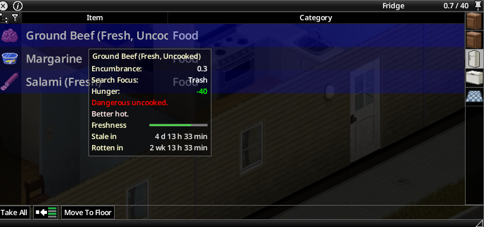

# Reading the labels

Hover any food item: the mod adds its lines at the bottom of the tooltip.

| Line | Meaning |
| --- | --- |
| **Freshness** bar | Life left before the food rots: full when new, empty when rotten. Green while fresh, orange once stale, red once rotten. |
| **Stale in** | Time before the food goes stale (shown only while it is still fresh). |
| **Rotten in** | Time before the food rots. |
| **Thawed in** | Frozen food outside a running freezer: time before it has thawed. See [Fridge and freezing](03-fridge-and-freezing.md). |
| **Frozen: not spoiling** | Frozen food in a running freezer. |
| **Not spoiling here** | The food does not age where it is (powered fridge with the sandbox Refrigeration Effectiveness set to no decay). |
| **Does not expire** | Food that never spoils, such as canned and dry food. |
| **Rotten** + **Disappears in** | Rotten food; the second line appears only when the sandbox *Rotten Food Removal* option is on, and not in a composter. |

## Time format

Largest units first, at most three of them: years (365 days), months (30 days), weeks, days, hours, minutes. Example: `2 wk 13 h 33 min`. Under one minute: `< 1 min`.

## Times that follow the game

The time left is projected the way the game ages food: sandbox *Food Spoilage* speed, fridge or freezer effect, frozen food, and each item's own stale and rotten ages (cooked food differs from raw food). It is recomputed every time the tooltip is shown: moving the food changes it.

## Rough state

If the [option](04-options.md) "Exact times need Nutritionist" is on and your character cannot read the exact times, the bar stays and one line gives a rough state: **Very fresh**, **Fresh**, **Looks okay**, **Starting to rot**, **Almost rotten** or **Rotten**.

## Inventory strip

Expand a stack in the inventory or in a container: each food that can spoil gets a thin strip at the bottom of its row, with the same colours as the freshness bar. The vanilla detail line stays visible.

> Capture à faire : expanded food stack in the inventory with green, orange and red strips.
