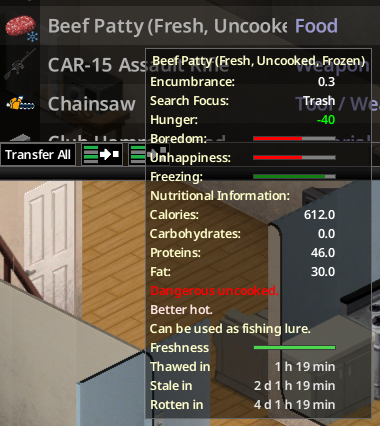

# Fridge and freezing

## Fridges and freezers

A fridge or freezer slows spoilage by the sandbox *Refrigeration Effectiveness* factor while it has power:

- **generator**: the slowdown applies as long as the square has generator power;
- **grid power**: the slowdown applies until the electricity shutoff day of the sandbox; the projected time switches to normal speed for the part after that day.

With *Refrigeration Effectiveness* set to no decay, a powered fridge shows **Not spoiling here**.

A future generator shutdown (out of fuel) is not anticipated: the time changes when it happens.

## Frozen food

Frozen food does not spoil until it has thawed.

- In a **running freezer**: **Frozen: not spoiling**.
- **Anywhere else**: **Thawed in**, then **Stale in** and **Rotten in** counted from the end of thawing.

Thawing takes 1.5 in-game hours from fully frozen, twice as long in a powered fridge, and six times faster in a warm container (stove, barbecue…). Partially frozen food takes proportionally less.

## Rotten food removal

When the sandbox *Rotten Food Removal* option is on, rotten food shows **Disappears in**: the time before the game deletes it. A composter keeps rotten food, so nothing is shown there.
